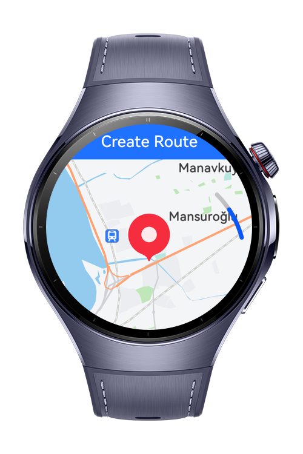
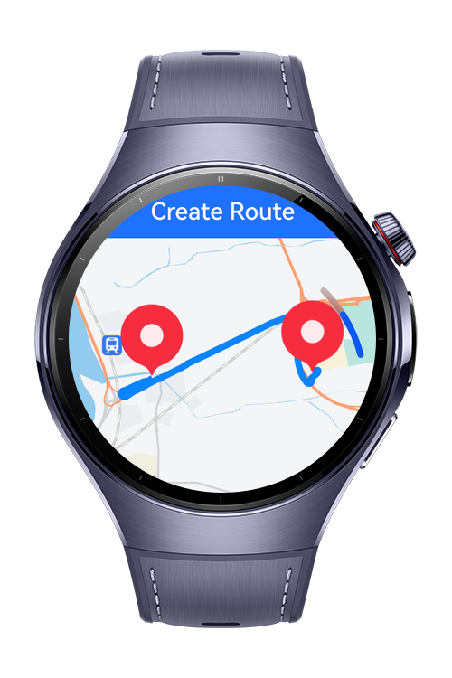

> **Note:** To access all shared projects, get information about environment setup, and view other guides, please visit [Explore-In-HMOS-Wearable Index](https://github.com/Explore-In-HMOS-Wearable/hmos-index).

# How to Display a Route with Markers on a Map

This is demonstrates how to create a route between two predefined points on a map in a HarmonyOS application.
It visualizes both locations with markers, and upon pressing a button, it dynamically draws the route between them.

# Preview
<div>
   
  
</div>


# Use Cases
This sample project is designed for developers and testers who want to explore map-based navigation features in HarmonyOS smartwatches without relying on live GPS data.

Practical scenarios include:

- Prototype Testing – Simulate navigation workflows using fixed coordinates before adding live location support.

- UI/UX Validation – Test smartwatch-friendly map interactions and route visualization without outdoor field tests.

- Learning & Experimentation – Gain hands-on experience with HarmonyOS Map APIs, POI search, and route drawing in a wearable environment.

# Technology

## Stack
- Languages: ArkTS
- Frameworks: HarmonyOS SDK 5.1.0(18)
- Tools: DevEco Studio Vers 5.1.0.823
- Libraries
    - `@kit.MapKit`: map, search, and route planning
    - `@kit.LocationKit`: getCurrentLocation
    - `@kit.AbilityKit`: permission check and request
    - `@kit.PerformanceAnalysisKit`


# Directory Structure
```
entry/src/main/ets/
|---pages
|   |---HomePage.ets          
|---services
|   |---NavigationService.ets 
|---resources
|---module.json5                   
```

# Constraints and Restrictions

## Supported Device
- Huawei Watch 5

## Preparations Before Run
- You must **manually sign the application** before running it.
- Otherwise, the map will appear as a **white screen** with no information.
- [🔗 Learn how to sign your application](https://developer.huawei.com/consumer/en/doc/harmonyos-guides/map-config-agc)

- [🔗 Map kit supported countries/regions](https://developer.huawei.com/consumer/en/doc/harmonyos-guides/map-supported)


# License
Map And Navigation App is distributed under the terms of the MIT License. See the [LICENSE](/LICENSE) for more information.